

  

  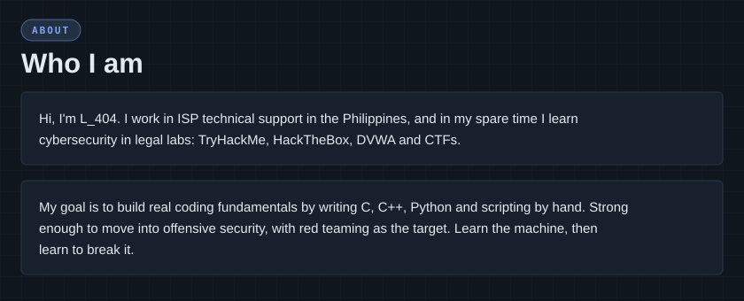

<a href="https://github.com/Johnsaro/Code-Practice-and-Projects">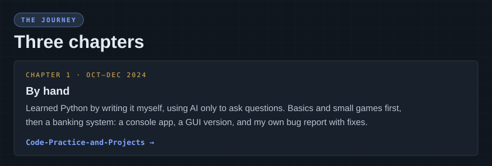</a> 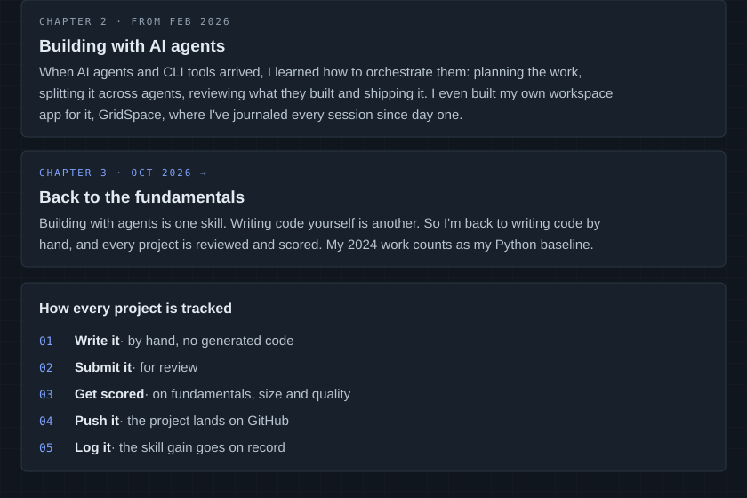

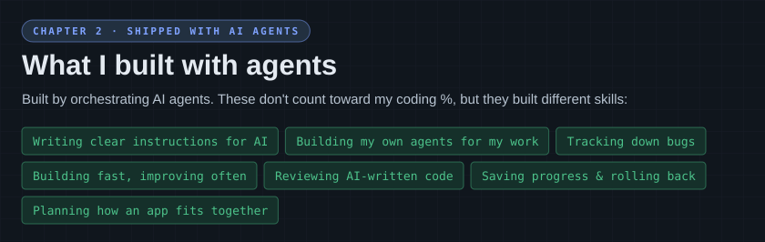 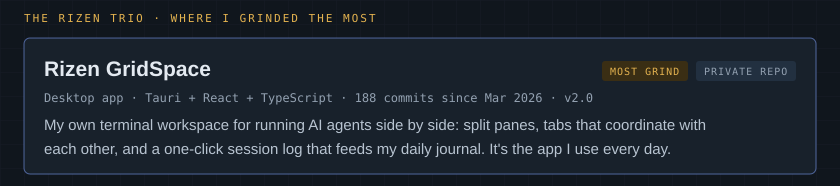 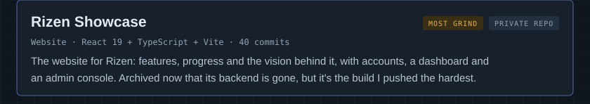 <a href="https://github.com/Johnsaro/Rizen">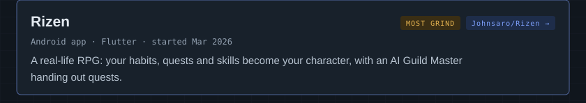</a> 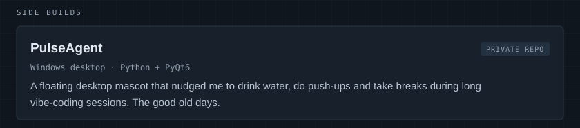 <a href="https://github.com/Johnsaro/phantom">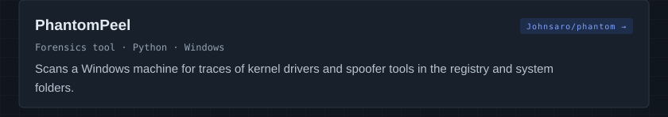</a> 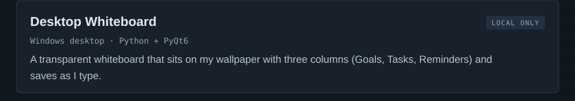

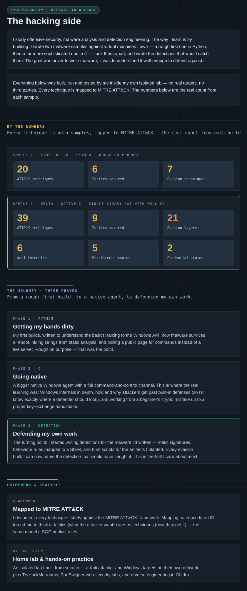

  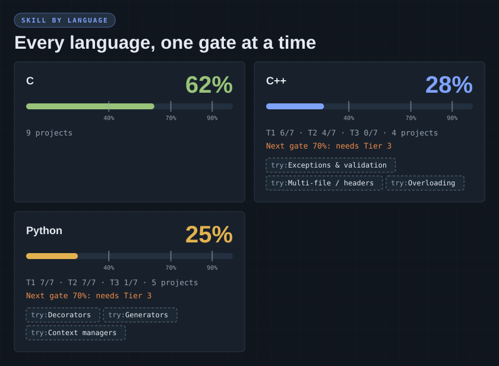

  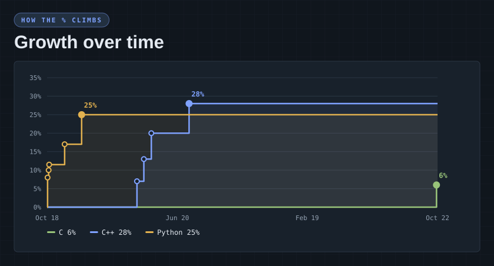

  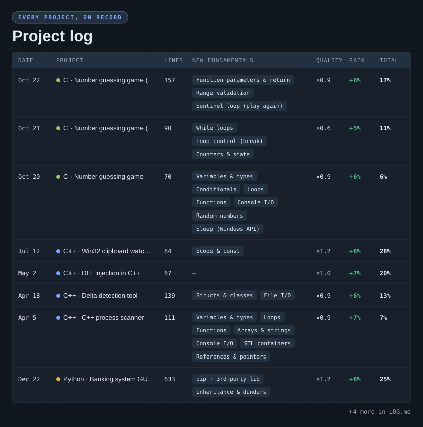

<a href="LOG.md">Full project log →</a>

<b>How scoring works</b>

 

Each project is reviewed and earns a skill gain for its language.

| Part | What counts |
|---|---|
| Fundamentals | Matters most. Using a concept for the **first time** earns the most. |
| Length | Adds **2 pts at most**, so more lines alone don't help much. |
| Quality | Multiplier from **×0.5** (messy) to **×1.2** (clean). |

Limits that keep it honest:

- **Max +8%** per project.
- **Diminishing returns:** gains shrink as the % gets higher.
- **Gates at 40%, 70% and 90%:** to pass one, a project has to use harder concepts.

  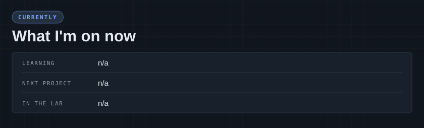

